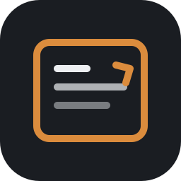
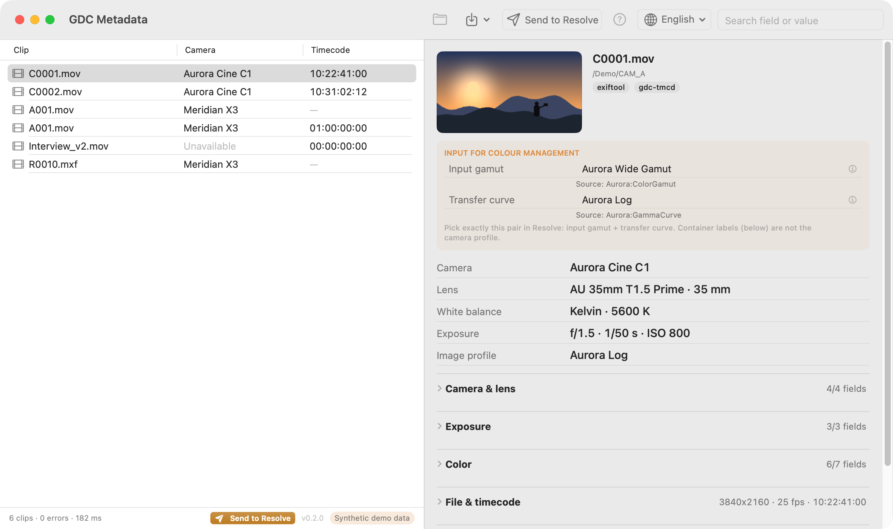
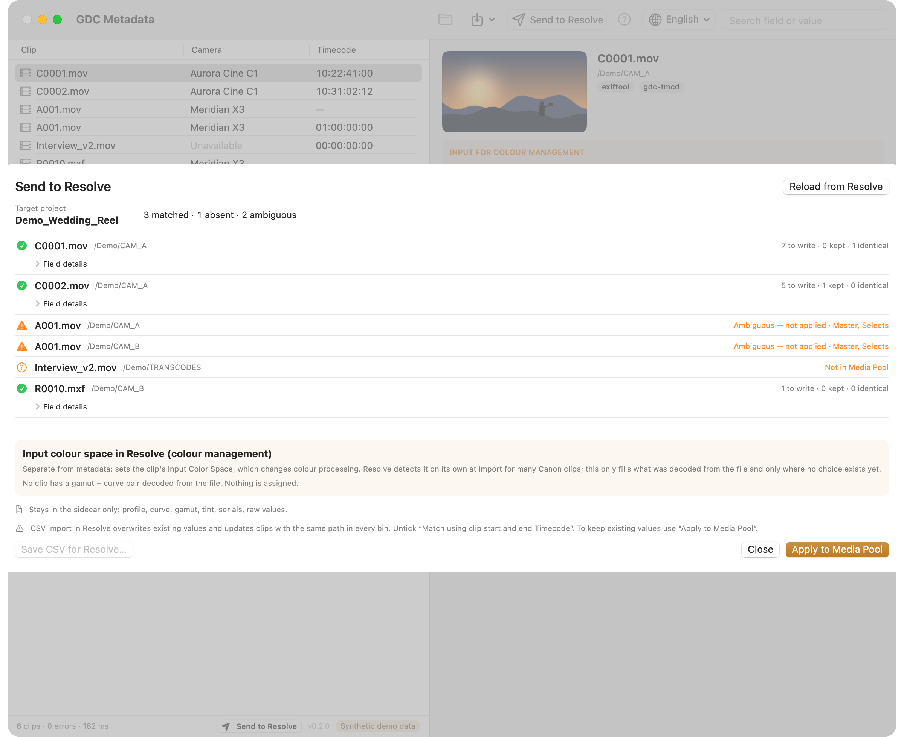

<p align="center"></p>

# GDC Metadata

**Sitio web: [https://gordas.dev/gdc-metadata/](https://gordas.dev/gdc-metadata/)**

Lee cámara, objetivo, exposición, balance de blancos, perfil de imagen y timecode de carpetas multicámara, muestra el origen de cada valor y los envía al Media Pool de DaVinci Resolve. Todo queda en tu Mac; los originales no se modifican.

**[Descargar para macOS](https://github.com/gordasgdc/gdc-metadata/releases/download/v0.1.1/GDCMetadata-0.1.1.dmg)** — Versión 0.1.1 · gratis · DMG firmado y notarizado

[English](README.md) · [Română](README.ro.md) · [Español](README.es.md) · Guía de uso: [EN](docs/guide.en.md) · [RO](docs/guide.ro.md) · [ES](docs/guide.es.md)

Manual (PDF): [RO](docs/manual/pdf/manual-ro.pdf) · [EN](docs/manual/pdf/manual-en.pdf) · [ES](docs/manual/pdf/manual-es.pdf) — https://gordas.dev/gdc-metadata/

¿Ya tienes la 0.1.0? Esa versión no tiene actualizador: instala una vez el nuevo DMG (arrastra la app sobre Applications y elige Reemplazar). Después usa el menú de la app → Buscar actualizaciones…



## Enviar a Resolve



- Los campos vacíos de Resolve se escriben; los valores existentes se conservan; un clip en varios bins se omite por ambiguo (verificado en Resolve tras reabrir el proyecto).
- El CSV es una alternativa, pero la importación de Resolve puede sobrescribir los valores existentes y, con nombres de archivo duplicados, todos los clips con ese nombre reciben los mismos valores. Opciones verificadas: Match using filename activado, Timecode inicio/fin desactivado.
- Junto a cada clip se escribe un sidecar <clip>.gdc-metadata.json; los originales solo se leen.

## Movimiento y estabilización

Los datos de movimiento detectados se listan con su origen y la nota «Compatibilidad con Gyroflow sin verificar». No se ofrece estabilización hasta demostrar una ruta antes/después en Resolve. Estado ilustrativo, datos sintéticos.

## Requisitos

- macOS 14 o posterior.
- ExifTool (por ejemplo: brew install exiftool).
- Python 3 de las Xcode Command Line Tools — solo para enviar a Resolve.
- DaVinci Resolve abierto, con External scripting en Local — solo para enviar a Resolve.

## Build

```sh
export GDC_BUILD_ROOT=/path/to/build-folder
sh scripts/build_app.sh
GDC_SAMPLE_CLIP=/path/to/clip.mp4 GDC_SYNTH_DIR=/path/to/dir cargo test --manifest-path core/Cargo.toml
```

Licencia MIT · © 2026 Cristi Gordaș · [THIRD_PARTY_NOTICES.md](THIRD_PARTY_NOTICES.md) · Todas las imágenes usan datos de demostración sintéticos.
