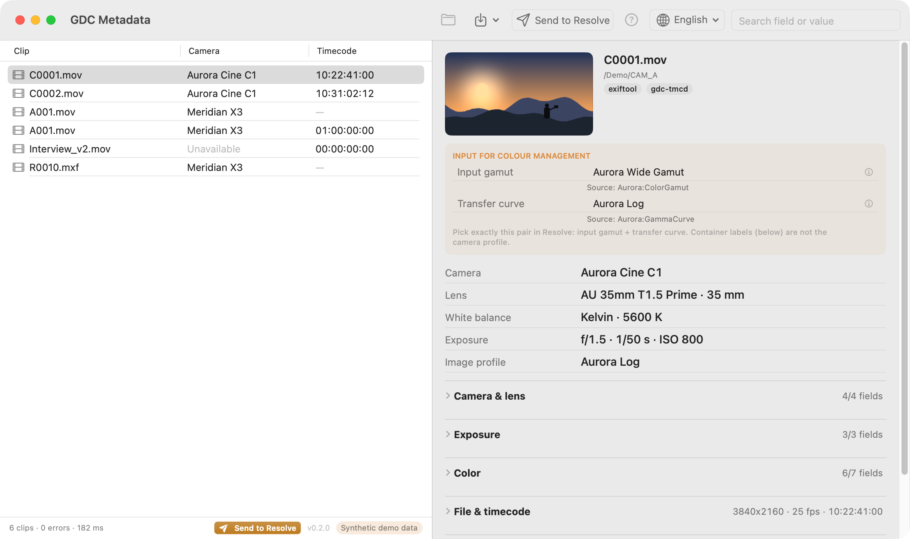
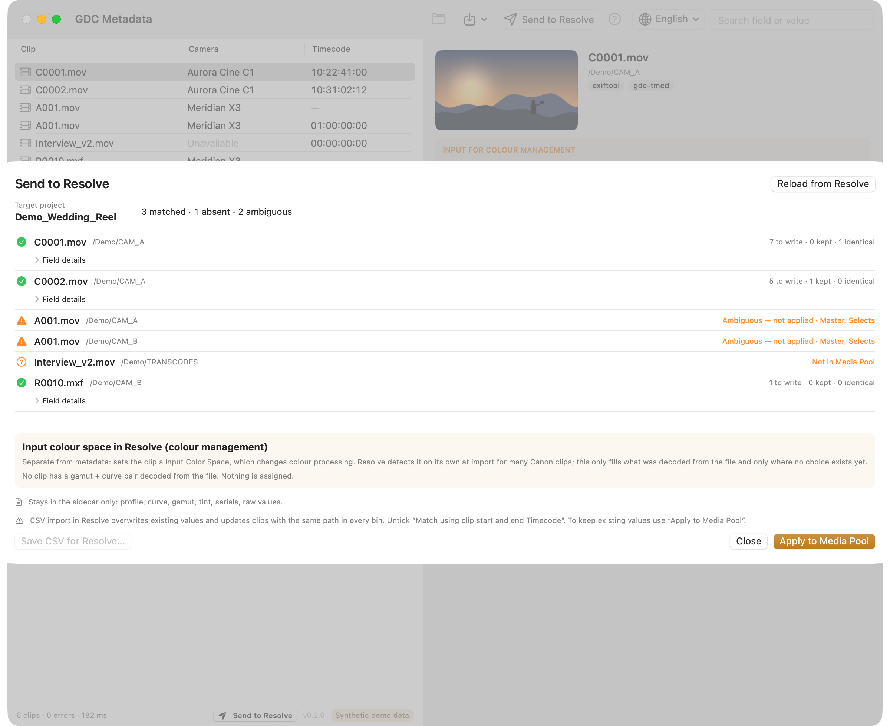

<p align="center"></p>

# GDC Metadata

**Website: [https://gordas.dev/gdc-metadata/](https://gordas.dev/gdc-metadata/)**

Read camera, lens, exposure, white balance, image profile and timecode from multi-camera folders, see where each value comes from and send it to the DaVinci Resolve Media Pool. Everything stays on your Mac; originals are never modified.

**[Download for macOS](https://github.com/gordasgdc/gdc-metadata/releases/download/v0.1.1/GDCMetadata-0.1.1.dmg)** — Version 0.1.1 · free · signed and notarized DMG

[English](README.md) · [Română](README.ro.md) · [Español](README.es.md) · User guide: [EN](docs/guide.en.md) · [RO](docs/guide.ro.md) · [ES](docs/guide.es.md)

Manual (PDF): [RO](docs/manual/pdf/manual-ro.pdf) · [EN](docs/manual/pdf/manual-en.pdf) · [ES](docs/manual/pdf/manual-es.pdf) — https://gordas.dev/gdc-metadata/

Already on 0.1.0? That version has no updater: install the new DMG once (drag the app over Applications, choose Replace). From then on use the app menu → Check for Updates…



## Send to Resolve



- Empty Resolve fields are written; existing values are kept; a clip present in several bins is skipped as ambiguous (verified in Resolve after reopening the project).
- CSV export is an alternative, but Resolve's import can overwrite existing values, and with duplicate file names every clip with that name gets the same values. Options verified: Match using filename on, clip start/end Timecode off.
- A sidecar <clip>.gdc-metadata.json is written next to each clip; originals are only read.

## Motion & stabilization

Detected motion data is listed with its source and marked “Gyroflow compatibility unverified”. Stabilization is not offered until a before/after route is demonstrated in Resolve. Illustrative state, synthetic data.

## Requirements

- macOS 14 or later.
- ExifTool (for example: brew install exiftool).
- Python 3 from the Xcode Command Line Tools — only for sending to Resolve.
- DaVinci Resolve running, with external scripting set to Local — only for sending to Resolve.

## Build

```sh
export GDC_BUILD_ROOT=/path/to/build-folder
sh scripts/build_app.sh
GDC_SAMPLE_CLIP=/path/to/clip.mp4 GDC_SYNTH_DIR=/path/to/dir cargo test --manifest-path core/Cargo.toml
```

MIT licence · © 2026 Cristi Gordaș · [THIRD_PARTY_NOTICES.md](THIRD_PARTY_NOTICES.md) · All images use synthetic demo data.
