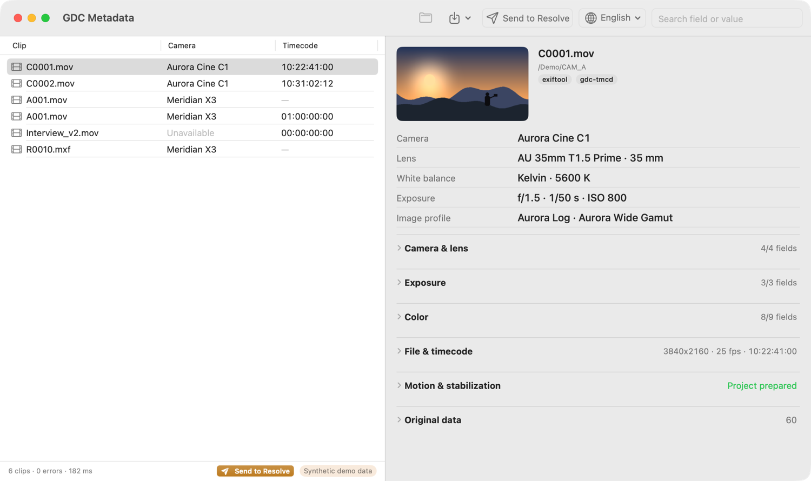
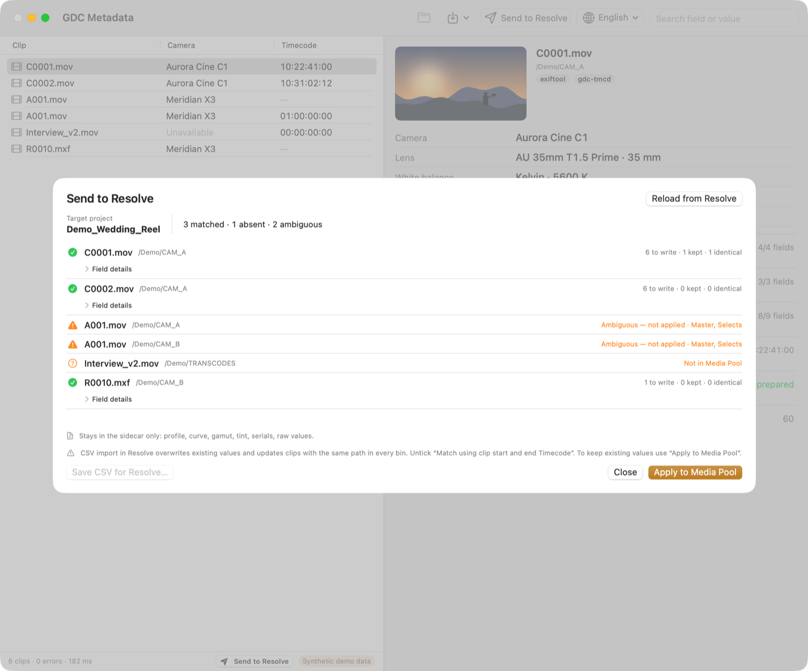

<p align="center"></p>

# GDC Metadata

Citește camera, obiectivul, expunerea, balansul de alb, profilul de imagine și timecode-ul din foldere multi-cameră, arată de unde vine fiecare valoare și le trimite în Media Pool din DaVinci Resolve. Totul rămâne pe Mac; originalele nu sunt modificate.

**[Descarcă pentru macOS](https://github.com/gordasgdc/gdc-metadata/releases/download/v0.1.0/GDCMetadata-0.1.0.dmg)** — Versiunea 0.1.0 · gratuit · DMG semnat și notarizat

[English](README.md) · [Română](README.ro.md) · [Español](README.es.md) · Ghid de utilizare: [EN](docs/guide.en.md) · [RO](docs/guide.ro.md) · [ES](docs/guide.es.md)



## Trimite în Resolve



- Câmpurile goale din Resolve se scriu; valorile existente se păstrează; un clip din mai multe bin-uri e omis ca ambiguu (verificat în Resolve după redeschiderea proiectului).
- CSV e o alternativă, dar importul din Resolve poate suprascrie valorile existente, iar la nume de fișier duplicate fiecare clip cu acel nume primește aceleași valori. Opțiuni verificate: Match using filename bifat, timecode start/end debifat.
- Lângă fiecare clip se scrie un sidecar <clip>.gdc-metadata.json; originalele sunt doar citite.

## Mișcare și stabilizare

Datele de mișcare detectate apar cu sursa lor și cu mențiunea „Compatibilitate Gyroflow neverificată”. Stabilizarea nu este oferită până nu există un traseu demonstrat înainte/după în Resolve. Stare ilustrativă, date sintetice.

## Cerințe

- macOS 14 sau mai nou.
- ExifTool (de exemplu: brew install exiftool).
- Python 3 din Xcode Command Line Tools — doar pentru trimiterea în Resolve.
- DaVinci Resolve pornit, cu External scripting setat pe Local — doar pentru trimiterea în Resolve.

## Build

```sh
export GDC_BUILD_ROOT=/path/to/build-folder
sh scripts/build_app.sh
GDC_SAMPLE_CLIP=/path/to/clip.mp4 GDC_SYNTH_DIR=/path/to/dir cargo test --manifest-path core/Cargo.toml
```

Licență MIT · © 2026 Cristi Gordaș · [THIRD_PARTY_NOTICES.md](THIRD_PARTY_NOTICES.md) · Toate imaginile folosesc date demo sintetice.
